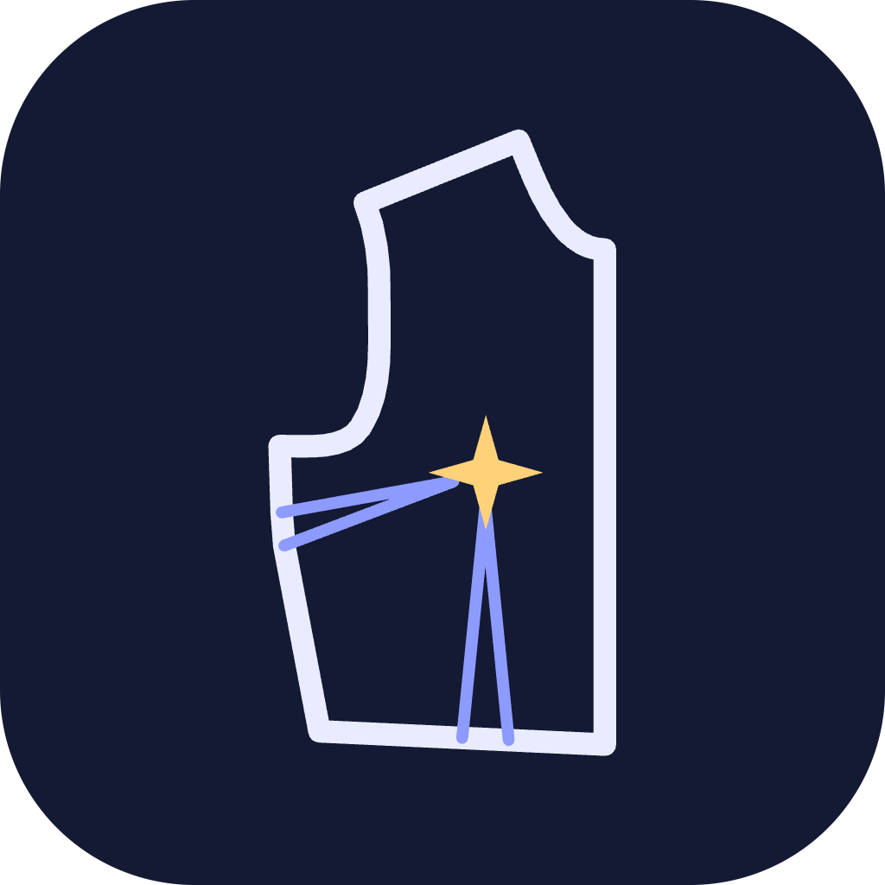

<p align="center"></p>

<h1 align="center">Andromeda Fashion Studio</h1>

<p align="center">Programas livres para confecção, no Mac e no Windows, em português:<br>
<b>Andromeda Draw</b> (desenho de moda e ficha técnica) · <b>Andromeda Moldes</b> (modelagem 2D, graduação, estampa, risco e encaixe) · Andromeda 3D (em breve)</p>

## Baixar

Vá em **[Releases](../../releases/latest)**. O jeito mais fácil é baixar só o **hub Andromeda Fashion Studio** (`Andromeda-Fashion-Studio-…`): por ele você instala, atualiza e abre o Draw e o Moldes, e organiza os produtos (cada referência com o desenho, a ficha e os moldes ligados).

Ou baixe os apps separados:

| Sistema | Andromeda Moldes | Andromeda Draw |
|---|---|---|
| Mac com chip Apple (M1, M2, M3…) | `Andromeda-Moldes-…-mac-arm64.dmg` | `Andromeda-Draw-…-mac-arm64.dmg` |
| Mac Intel | `Andromeda-Moldes-…-mac-x64.dmg` | `Andromeda-Draw-…-mac-x64.dmg` |
| Windows 10/11 | `Andromeda-Moldes-…-windows-instalador.exe` | `Andromeda-Draw-…-windows-instalador.exe` |

- **Mac:** abra o `.dmg` e arraste o app para **Aplicativos**. Na primeira vez, clique com o **botão direito › Abrir** (o app ainda não tem assinatura paga da Apple).
- **Windows:** se aparecer a tela azul do SmartScreen, clique em **Mais informações › Executar assim mesmo**.

## Hub — Andromeda Fashion Studio

- **Apps:** instala o Draw e o Moldes com um clique (baixa a versão certa para Mac com chip Apple, Mac Intel ou Windows), avisa quando há versão nova e abre cada app.
- **Produtos:** uma pasta de trabalho com as referências. "Nova referência" cria a pasta do produto com o desenho (`.adraw`) e os moldes (`.ctx`) já vinculados; cada linha abre o desenho no Draw e os moldes no Moldes.

## Andromeda Draw — desenho de moda e ficha técnica

- **Desenho vetorial** inspirado no Illustrator: seleção, seleção direta (pontos e alças), caneta com curvas, linha, retângulo, elipse, texto, camadas, agrupar, desfazer.
- **Simetria:** desenhe metade da peça e o outro lado acompanha; meio contorno que fecha no eixo vira a peça inteira.
- **Pespontos que acompanham o traço:** simples, duplo, triplo, zigue-zague, galoneira, overloque, corrente, alinhavo, zíper, franzido e elástico — com distância da borda e entre agulhas em medidas reais da peça.
- **Biblioteca:** peças base paramétricas (camiseta, regata, camisa social, moletom, calça jeans 5 bolsos, shorts, saia, vestido — com opções de gola, manga, modelagem e medidas), detalhes (bolsos, golas, punhos, passantes, zíper, cordão), aviamentos (botões, ilhós, rebite, colchete, fivela, etiqueta, cursor…), tecidos como preenchimento (jeans, listras, xadrez, vichy, poá, canelado, tricô, pied-de-poule…) e croquis em 9 cabeças.
- **Ficha técnica** no mesmo arquivo (`.adraw`): referência, desenho, tabela de medidas por tamanho com tolerância, materiais, aviamentos (contados direto do desenho), sequência operacional, cores, símbolos de cuidado e vínculo com o arquivo de moldes (`.ctx`) — sai em PDF A4.
- **Importa** SVG do Illustrator, CorelDRAW, Inkscape ou Figma (traços editáveis, com cores, espessuras, grupos e medidas certas), imagens PNG/JPG/WebP (foto da peça-piloto ou esboço para redesenhar por cima) e moldes do Andromeda Moldes (`.ctx`) ou DXF-AAMA, que viram desenho na escala do documento. Dá também para arrastar o arquivo direto para a prancha.
- **Exporta** SVG (abre no Illustrator, Inkscape, CorelDRAW) e PNG.

## Andromeda Moldes — o que ele faz

- **Moldes:** reta, curvatura, retângulo exato, linhas internas, pences (criar e transferir), cortar, unir, dobrar/desdobrar, pregas, folgas (paralela e em leque), piques, ponto por coordenada, andar molde e conferir costuras.
- **Margens e barras:** margem por borda e barra com cantos espelhados (mangas, calças, saias).
- **Bases prontas (tamanho M, já graduadas):** corpo base, manga, t-shirt, camisa, saia, calça, bermuda, blazer/paletó e terno, feminino e masculino.
- **Graduação** por regras nos pontos, com ninho de tamanhos.
- **Estampas** localizada, total, corrida e textura, com arte por tamanho, escala e giro pelo mouse.
- **Risco e encaixe** automático, consumo de tecido e **arquivo para gráfica de sublimação** (TIFF/PDF em tamanho real).
- **Saídas exatas 1:1:** plotter (PLT/HPGL), PDF (inteiro ou em folhas A4/A3) e DXF-AAMA (importar e exportar — Audaces, Gerber, Lectra, Optitex…).
- **Unidade** em mm, cm ou polegada; **Ajuda** que entende o que você escreve ("quero fazer a barra da manga") e mostra na tela onde clicar.

## Para desenvolvedores

Monorepo (npm workspaces): núcleo de geometria em `packages/core`, bases paramétricas de moldes em `packages/bases`, o Andromeda Moldes (Electron + React + Canvas) em `apps/modelagem-2d`, o Andromeda Draw (Electron + React + SVG) em `apps/draw` e o hub em `apps/hub`.

## Princípio de exatidão

- Toda geometria interna em **milímetros** (float64), eixo Y para cima.
- Conversões só na exportação: PLT 40 unidades/mm (erro ≤ 0,0125 mm por ponto, sem acúmulo); PDF em pontos com 4 casas.
- PDF sai com `PrintScaling /None` e recusa páginas acima do limite em vez de reduzir a escala.
- Cada exportador tem teste automático que mede o resultado (`npm test`).

## Estrutura

```
packages/core/          núcleo compartilhado
  src/units.ts          unidades e conversões
  src/geometry.ts       vetores, curvas Bézier, achatamento, margem de costura
  src/pattern.ts        molde (Piece), documento, arquivo .ctx
  src/plot.ts           camada comum de plotagem (traços + textos)
  src/export/hpgl.ts    PLT/HPGL
  src/export/pdf.ts     PDF vetorial 1:1
  src/edit.ts           edição de moldes (pontos, curvas, piques presos à borda)
  src/modelagem.ts      pence, transferir, cortar, unir, dobrar, prega, folgas, curvatura
  src/walk.ts           andar molde
  src/grading.ts        gradação por regra nos pontos
  src/marker.ts         risco e encaixe (automático, otimização, enfesto, PLT)
  test/                 testes de precisão + gerador de prova
packages/bases/         biblioteca de bases paramétricas (tamanho M, fem. e masc.)
  src/medidas.ts        tabelas de medidas (editáveis)
  src/torso.ts          armação do torso + manga (cabeça calculada sobre a cava)
  src/superiores.ts     corpo base, manga base, t-shirt, camisa
  src/inferiores.ts     saia reta, calça, bermuda
  src/alfaiataria.ts    paletó/blazer (3 partes, manga 2 partes), terno
apps/modelagem-2d/      Andromeda Moldes (Electron + React + Canvas)
apps/hub/               hub Andromeda Fashion Studio (instala/abre os apps, produtos)
apps/draw/              Andromeda Draw (Electron + React + SVG)
  src/model/            documento, simetria, pespontos, tecidos, aviamentos, ficha
  src/lib/              biblioteca: peças base paramétricas, detalhes, croquis
  src/ui/               área de desenho, biblioteca, painel, ficha técnica
```

### Bases disponíveis (tamanho M)

| Feminino | Masculino |
|---|---|
| Corpo base, Manga base | Corpo base, Manga base |
| T-shirt (malha) | T-shirt (malha) |
| Camisa | Camisa social (com pala) |
| Saia reta | — |
| Calça, Bermuda | Calça social, Bermuda |
| Blazer, Terninho | Paletó, Terno |

Cada base traz ficha completa: descrição, tecido, aviamentos, folgas, margens por borda, quantidades de corte,
observações por molde e **conferências calculadas** (cava × cabeça da manga, costuras que se unem, cintura/quadril acabados).

## Comandos

```bash
npm install
npm test          # testes de precisão
npm run prova     # gera out/prova-escala.{plt,pdf,ctx}
npm run bases     # gera PDF/PLT/CTX de todas as bases em out/bases/
npm run dev -w @cad-textil/modelagem-2d    # abre o editor desktop
npm run dist:mac -w @cad-textil/modelagem-2d   # instaladores do Mac em apps/modelagem-2d/release
npm run icons -w @cad-textil/modelagem-2d      # regera os ícones a partir de build/icon.svg
npm run dev -w @cad-textil/draw                # abre o Andromeda Draw
npm run dist:mac -w @cad-textil/draw           # instaladores do Draw em apps/draw/release
npm run dev -w @cad-textil/hub                 # abre o hub
```

**Nova versão:** mude `version` em `apps/modelagem-2d/package.json`, `apps/draw/package.json` e `apps/hub/package.json`, crie a tag (`git tag v0.2.0 && git push --tags`) e o GitHub Actions gera os instaladores de Mac e Windows e publica em Releases.

**Conferência física:** imprima `out/prova-escala.pdf` em "Tamanho real / 100%" ou envie o `.plt` ao plotter. O quadrado deve medir 100 × 100 mm, a régua 500 mm e o retângulo 500 × 200 mm.

## Roadmap

1. ✅ Núcleo: geometria em mm, margem de costura, PLT, PDF, arquivo `.ctx`
2. ✅ Editor Modelagem 2D + biblioteca de bases M, gradação, estampas
3. ✅ PDF em folhas A4/A3; importar/exportar DXF-AAMA
4. ✅ Risco e Encaixe v0.2: grade com vários intervalos (encaixe nos vãos), bottom-left com tolerância e antecipação, otimização por busca local (ordem, rotação, tolerância) · próximo: minimização de sobreposição (aproveitamento 80–88%), riscos múltiplos, tecido tubular/listrado
5. ✅ Andromeda Draw v0.1: desenho técnico com simetria, pespontos, biblioteca e ficha técnica em PDF · próximo: mais peças e detalhes, cotas, variações de cor, consumo puxado do risco
6. Costuras (ligação entre bordas de moldes)
7. Andromeda 3D: avatar, montagem, simulação de tecido, sincronia 2D↔3D
8. ✅ Hub Andromeda Fashion Studio v0.1: instala, atualiza e abre os apps; produtos com desenho, ficha e moldes ligados

## Contribuir

O Andromeda Moldes é **código aberto (licença MIT)**: qualquer pessoa pode usar, estudar, modificar e redistribuir, inclusive em uso comercial, mantendo o aviso de licença.

- Achou um problema ou tem uma ideia? Abra uma **[Issue](../../issues)** contando o que fez e o que esperava (uma foto da tela ajuda).
- Quer mexer no código? Faça um fork, crie um branch, rode `npm install` e `npm test`, e mande um **Pull Request**. Os testes de precisão (escala 1:1) precisam continuar passando.
- Tudo por dentro é em milímetros; textos da interface em português do Brasil.

## Licença

[MIT](LICENSE) © 2026 Joao Wellington e colaboradores.
